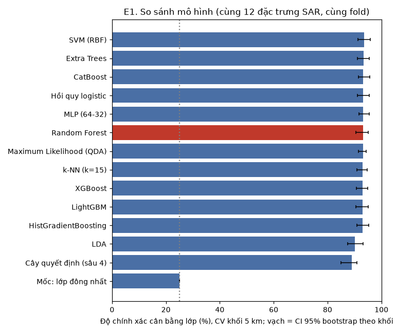
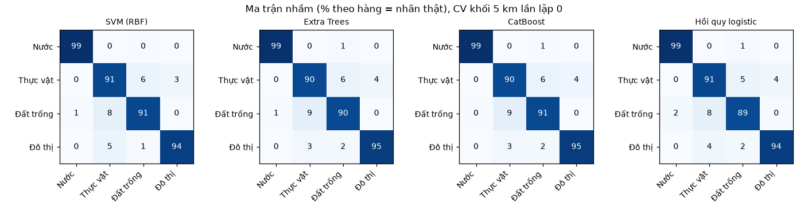
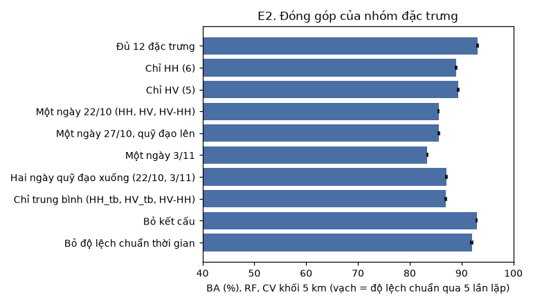
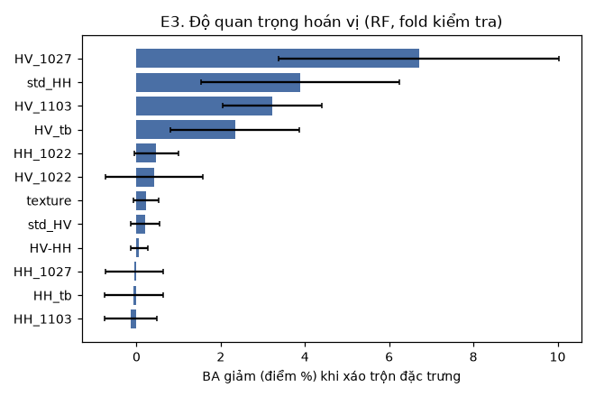
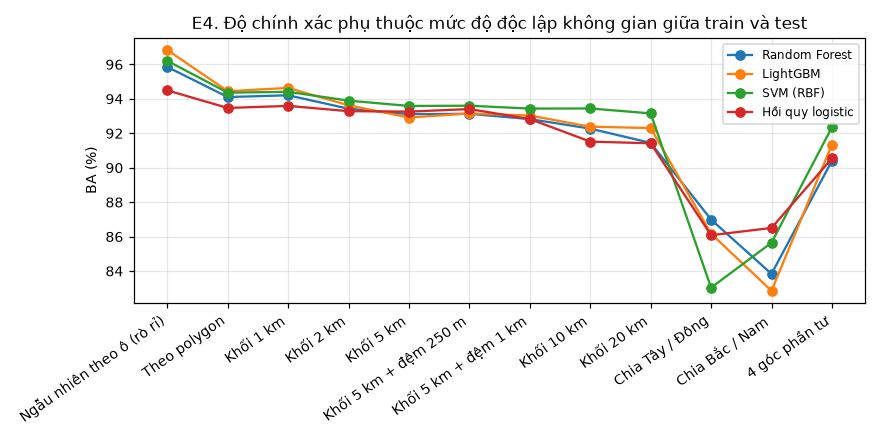
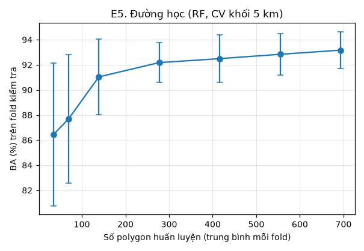
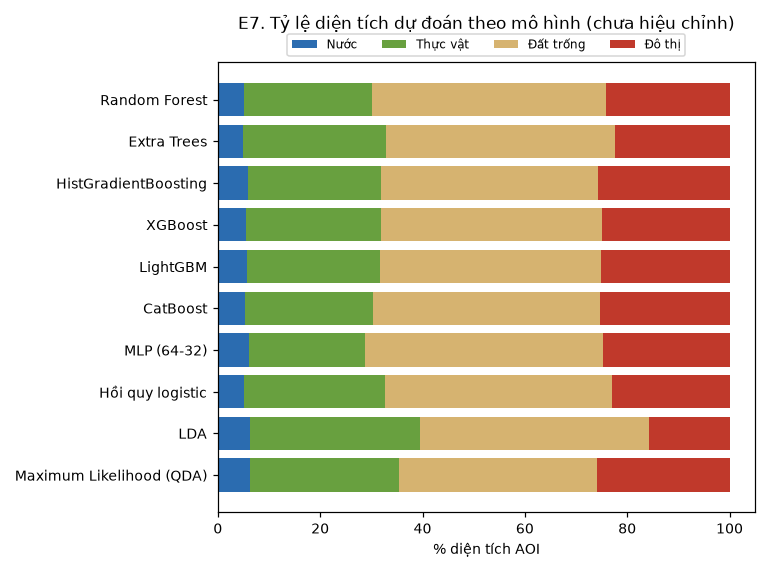
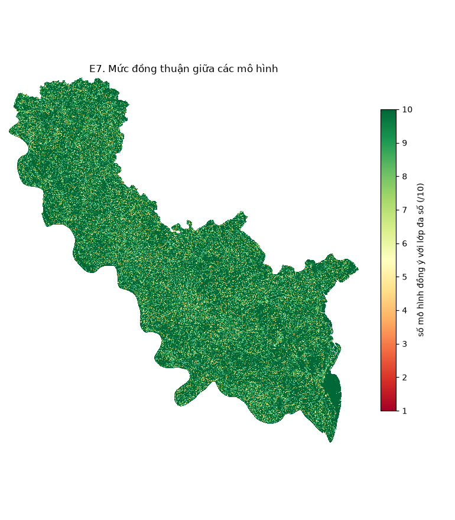
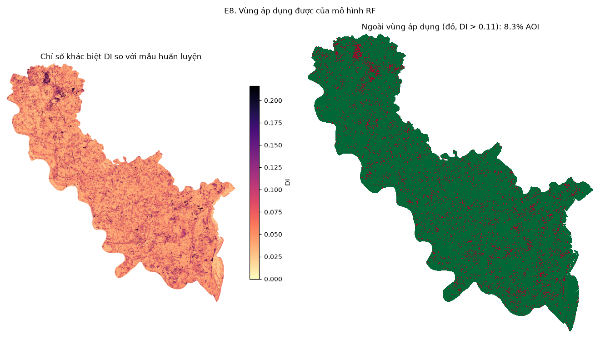

# Phân loại lớp phủ 4 lớp chỉ từ SAR NISAR: so sánh mô hình và kiểm chứng

Dự án *Dancing with the SARs* (NASA Space Apps 2026) · tỉnh Hưng Yên (sau sáp nhập 2025) · số liệu chạy ngày 14/11/2026

Toàn bộ số liệu trong báo cáo đến từ `scripts/experiments.py` (log đầy đủ: [`log.txt`](log.txt)), trừ phân bố khoảng cách của ô AOI tới mẫu huấn luyện ở mục 5.4, được tính riêng một lần.

---

## Tóm tắt

- **Bài toán.** Phân loại mỗi ô 20 m của tỉnh vào 4 lớp: Nước, Thực vật, Đất trống, Đô thị/làng. Đầu vào **chỉ là SAR**: NISAR GCOV tần số L, 3 ngày 22/10, 27/10, 3/11/2026, phân cực HH và HV. Nhờ vậy bản đồ áp dụng được cả nơi ảnh quang học bị mây, tức khoảng 69% diện tích tỉnh trong giai đoạn này.
- **Độ chính xác trên ô thuần** theo kiểm tra chéo khối không gian 5 km: **độ chính xác cân bằng lớp (BA) khoảng 93%**, độ chính xác tổng (OA) khoảng 95%, kappa khoảng 0,93. Mốc so sánh "luôn đoán lớp đông nhất" đạt BA 25%.
- **Mô hình không phải yếu tố quyết định.** 10 trong 14 mô hình đạt BA 93,0-93,6%, khoảng tin cậy chồng lên nhau. Không mô hình nào tốt hơn Random Forest một cách đáng kể, kể cả sau khi tinh chỉnh siêu tham số.
- **Yếu tố quyết định là dữ liệu đa thời gian.** Dùng 1 ngày ảnh chỉ đạt BA 83-86%, dùng 3 ngày đạt 93%. HV (phân cực chéo) là phân cực có ích nhất.
- **Độ chính xác giảm khi xa vùng có nhãn.** Chia ngẫu nhiên theo ô thổi phồng khoảng 3 điểm. Chia theo nửa tỉnh chỉ còn 84-87%, một phần do nhãn phân bố lệch giữa các vùng.
- **Giới hạn quan trọng nhất:** chưa có tập kiểm tra độc lập, và mọi con số đều đo trên ô 20 m nằm trọn trong một polygon nhãn (ô thuần). **Không được đọc con số 93% là độ chính xác của toàn bộ bản đồ.** Tỷ lệ diện tích từng lớp chưa được kiểm chứng; lớp Đô thị kém tin cậy nhất.

---

## 1. Dữ liệu

| Thành phần | Chi tiết |
|---|---|
| SAR | NISAR L2 GCOV, sản phẩm VALIDATED (CRID P05036), tần số A, phân cực HH và HV, backscatter đã hiệu chỉnh địa hình. Ba ngày: 22/10 (track 148, quỹ đạo xuống, 20 m), 27/10 (track 054, quỹ đạo lên, 10 m, lấy trung bình về 20 m), 3/11 (track 148, quỹ đạo xuống, 20 m). Ngày 29/10 bị loại vì chỉ phủ 4% AOI. |
| Lưới phân tích | UTM 48N (EPSG:32648), ô 20 m, cắt theo ranh giới tỉnh: 6,43 triệu ô, 2.571,7 km² (diện tích hình học của ranh giới AOI). |
| Ảnh quang học | Sentinel-2 SR median 22/10-3/11, 10 m, lọc mây bằng Cloud Score+ (ngưỡng 0,789), xuất từ Google Earth Engine. **Chỉ dùng để người chấm nhìn khi vẽ nhãn, không đưa vào mô hình.** Chỉ khoảng 32% AOI có ít nhất một quan sát sạch. |
| Nhãn | 1.347 polygon hình chữ nhật vẽ trong ArcGIS Pro trên ảnh S2 10 m: Nước 190, Thực vật 485, Đất trống 444, Công trình (= Đô thị/làng) 228. Gộp vào `labeling/labels_polygon.gpkg`. |

## 2. Từ polygon đến mẫu huấn luyện

- **Ô thuần:** một ô 20 m được dùng làm mẫu nếu ≥80% diện tích của nó thuộc một lớp. Độ phủ tính bằng siêu lấy mẫu 8×8 mỗi ô; với 4×4, ngưỡng 80% bị làm tròn thành 100%.
- **Giới hạn mỗi polygon:** tối đa 20 ô, chọn ngẫu nhiên, để polygon nước lớn không áp đảo.
- **Kết quả:** **3.918 mẫu** từ 864 polygon: Nước 2.011, Thực vật 622, Đất trống 660, Đô thị 625.
- **483 polygon (36%) không cho mẫu nào**, vì quá nhỏ để chứa trọn một ô 20 m. Phần lớn là polygon thực vật; trung vị diện tích polygon thực vật là 568 m², trong khi một ô là 400 m².

**Phân bố không gian của nhãn (E0)**
- Polygon được vẽ thành cụm cùng lớp: khoảng cách tới polygon *cùng lớp* gần nhất có trung vị 102 m, tới polygon *khác lớp* gần nhất có trung vị 509 m. Không có polygon nào chạm nhau.
- Mẫu rải trên 88 khối 5×5 km, nhưng 10 khối đông nhất chứa 48% số mẫu. Mỗi lớp chỉ có mặt ở 33-45 khối.
- Hệ quả: độ đa dạng thật của tập nhãn thấp hơn nhiều so với con số 3.918 ô.

## 3. Đặc trưng (12, trên mỗi ô 20 m)

Backscatter đổi sang dB, làm trơn trung bình 3×3 (60 m) để giảm speckle.

| Nhóm | Đặc trưng |
|---|---|
| Từng ngày | HH và HV của 22/10, 27/10, 3/11 (6 đặc trưng) |
| Tổng hợp | HH trung bình, HV trung bình, HV − HH (tỷ số phân cực chéo, dB) |
| Biến động | Độ lệch chuẩn HH và HV qua 3 ngày |
| Kết cấu | Độ lệch chuẩn cục bộ 7×7 (140 m) của HH trung bình |

Lưu ý: ngày 27/10 chụp từ quỹ đạo lên, khác hướng nhìn với hai ngày còn lại. Vì vậy "biến động qua 3 ngày" gồm cả khác biệt do hướng nhìn, không chỉ do mặt đất thay đổi.

## 4. Phương pháp kiểm chứng

- **Chỉ số chính, chốt trước khi chạy:** độ chính xác cân bằng lớp (BA), tức trung bình recall của 4 lớp. Dùng BA vì Nước chiếm 51% số mẫu, khiến độ chính xác tổng bị kéo lên.
- **Cách chia chính:** kiểm tra chéo 5 fold theo **khối không gian 5×5 km** (`StratifiedGroupKFold`): mọi ô trong cùng khối nằm cùng phía train hoặc test. Lặp 5 lần với cách phân khối vào fold khác nhau. Mọi mô hình dùng chung các fold.
- **Chỉ số bổ sung:** độ chính xác tổng (OA), F1 macro, kappa của Cohen, F1 từng lớp, ma trận nhầm.
- **Độ bất định:** khoảng tin cậy 95% bằng bootstrap theo khối (lấy lại khối 5 km có hoàn lại, 2.000 lần). Hiệu BA so với Random Forest được tính trên cùng các mẫu bootstrap. Kiểm định McNemar được báo kèm, nhưng giá trị p của nó lạc quan vì các ô gần nhau không độc lập.
- **Siêu tham số:** dùng giá trị mặc định hợp lý, không tinh chỉnh trên chính CV đánh giá. Tác dụng của tinh chỉnh được đo riêng bằng CV lồng (mục 5.6).

## 5. Kết quả

### 5.1 So sánh 14 mô hình (E1)



| Mô hình | BA (CI 95%) | OA | F1 macro | kappa | F1 Nước | F1 Thực vật | F1 Đất trống | F1 Đô thị |
|---|---|---|---|---|---|---|---|---|
| SVM (RBF) | **93,6** (91,4-95,8) | 95,6 | 93,5 | 0,933 | 99,5 | 88,4 | 91,4 | 94,7 |
| Extra Trees | 93,3 (91,1-95,6) | 95,3 | 93,2 | 0,929 | 99,4 | 88,6 | 89,5 | 95,3 |
| CatBoost | 93,3 (91,4-95,6) | 95,3 | 93,1 | 0,929 | 99,5 | 88,1 | 89,6 | 95,3 |
| Hồi quy logistic | 93,3 (91,2-95,4) | 95,3 | 93,2 | 0,929 | 99,3 | 89,1 | 89,8 | 94,8 |
| MLP (64-32) | 93,2 (91,8-95,4) | 95,5 | 93,4 | 0,931 | 99,4 | 89,0 | 90,2 | 94,7 |
| Random Forest | 93,1 (90,5-95,0) | 95,3 | 93,1 | 0,929 | 99,5 | 88,1 | 89,6 | 95,1 |
| Maximum Likelihood (QDA) | 93,1 (91,5-94,4) | 94,6 | 92,7 | 0,918 | 98,4 | 88,9 | 88,1 | 95,3 |
| k-NN (k=15) | 93,1 (91,0-94,8) | 95,3 | 93,3 | 0,929 | 99,2 | 88,8 | 90,1 | 95,1 |
| XGBoost | 93,1 (90,7-95,0) | 95,2 | 93,0 | 0,928 | 99,5 | 87,8 | 89,7 | 94,9 |
| LightGBM | 93,0 (90,5-95,0) | 95,2 | 92,9 | 0,927 | 99,6 | 87,5 | 89,6 | 95,0 |
| HistGradientBoosting | 93,0 (90,9-95,2) | 95,1 | 92,8 | 0,926 | 99,5 | 87,6 | 89,7 | 94,6 |
| LDA | 90,2 (87,4-93,1) | 93,5 | 90,7 | 0,900 | 98,6 | 85,6 | 85,2 | 93,3 |
| Cây quyết định (sâu 4) | 88,9 (84,9-90,8) | 92,0 | 88,7 | 0,879 | 98,4 | 83,3 | 83,3 | 89,9 |
| Mốc: luôn đoán lớp đông nhất | 25,0 | 51,3 | 17,0 | 0,000 | 67,8 | 0 | 0 | 0 |

Các giá trị BA, OA, F1 tính bằng %; BA, OA, F1, kappa là trung bình qua 5 lần lặp; khoảng tin cậy từ bootstrap theo khối trên lần lặp đầu.

- **Nhận xét chính:** 10 mô hình đứng đầu chênh nhau dưới 1 điểm BA. Hiệu so với Random Forest dao động −0,0 đến +0,8 điểm, và khoảng tin cậy của hiệu hoặc chứa 0 hoặc sát 0.
- **Mô hình tuyến tính đủ tốt:** hồi quy logistic (93,3%) ngang các mô hình cây phức tạp. Dữ liệu với 12 đặc trưng này gần như tách được bằng biên tuyến tính.
- **Mô hình yếu hơn rõ:** chỉ LDA (−2,6 điểm) và cây quyết định nông (−4,8 điểm) kém Random Forest một cách đáng kể.
- **Thời gian huấn luyện** mỗi lần (khoảng 3.100 mẫu): từ 0,003 s (LDA) đến 6,5 s (HistGradientBoosting); Random Forest 0,4 s.



- **Nhầm chính ở mọi mô hình là Thực vật ↔ Đất trống,** khoảng 6-9% mỗi chiều. Tiếp theo là Đô thị bị đoán thành Thực vật (3-5%).
- **Nước gần như không nhầm** (99%).

### 5.2 Đóng góp của nhóm đặc trưng (E2, Random Forest)



| Bộ đặc trưng | Số đặc trưng | BA |
|---|---|---|
| Đủ 12 đặc trưng | 12 | **93,1** |
| Bỏ kết cấu | 11 | 92,9 |
| Bỏ độ lệch chuẩn thời gian | 10 | 92,0 |
| Chỉ HV | 5 | 89,4 |
| Chỉ HH | 6 | 88,9 |
| Hai ngày quỹ đạo xuống (22/10, 3/11) | 4 | 87,0 |
| Chỉ trung bình (HH, HV, HV − HH) | 3 | 86,9 |
| Một ngày 22/10 | 3 | 85,6 |
| Một ngày 27/10 (quỹ đạo lên) | 3 | 85,6 |
| Một ngày 3/11 | 3 | 83,4 |

- **Đa thời gian quan trọng nhất:** 3 ngày cho BA cao hơn 1 ngày 7-10 điểm. Lợi ích đến cả từ việc có nhiều quan sát lẫn từ có hai hướng nhìn: hai ngày cùng quỹ đạo xuống chỉ đạt 87,0%.
- **Cần cả hai phân cực:** bỏ HV hay bỏ HH đều mất khoảng 4 điểm.
- **Kết cấu gần như không đóng góp** (0,2 điểm), nên có thể bỏ.

### 5.3 Độ quan trọng hoán vị (E3, Random Forest, trên fold kiểm tra)



Mức BA giảm khi xáo trộn ngẫu nhiên một đặc trưng:

| Đặc trưng | BA giảm (điểm) |
|---|---|
| HV ngày 27/10 | 6,7 ± 3,3 |
| Độ lệch chuẩn HH | 3,9 ± 2,4 |
| HV ngày 3/11 | 3,2 ± 1,2 |
| HV trung bình | 2,3 ± 1,5 |
| Các đặc trưng còn lại | dưới 0,5 |

- **HV ngày 27/10 quan trọng nhất,** và đây là ngày duy nhất chụp từ quỹ đạo lên. Độ lệch chuẩn HH đứng thứ hai. Đặc trưng này lẫn khác biệt hướng nhìn, mà backscatter của nhà cửa phụ thuộc hướng nhìn, nên có thể có ý nghĩa vật lý. Tôi chưa kiểm chứng giả thuyết này.
- **Cách đọc:** khi nhiều đặc trưng tương quan với nhau (ví dụ HH từng ngày và HH trung bình), độ quan trọng riêng lẻ của mỗi cái bị chia nhỏ. Vì vậy cần đọc bảng này cùng với E2.

### 5.4 Cách kiểm chứng và rò rỉ không gian (E4)



| Cách chia train/test | Khoảng cách test → train (trung vị) | RF | LightGBM | SVM | Hồi quy logistic |
|---|---|---|---|---|---|
| Ngẫu nhiên theo ô (rò rỉ) | 20 m | 95,9 | 96,8 | 96,2 | 94,5 |
| Theo polygon | 300 m | 94,1 | 94,4 | 94,4 | 93,5 |
| Khối 1 km | 501 m | 94,2 | 94,6 | 94,4 | 93,6 |
| Khối 2 km | 800 m | 93,4 | 93,6 | 93,9 | 93,3 |
| **Khối 5 km (chính)** | 1.686 m | **93,1** | 92,9 | 93,6 | 93,3 |
| Khối 5 km + vùng đệm 250 m | 1.920 m | 93,1 | 93,2 | 93,6 | 93,4 |
| Khối 5 km + vùng đệm 1 km | 2.500 m | 92,8 | 93,0 | 93,4 | 92,8 |
| Khối 10 km | 2.925 m | 92,3 | 92,4 | 93,4 | 91,5 |
| Khối 20 km | 4.099 m | 91,4 | 92,3 | 93,2 | 91,4 |
| Chia Tây / Đông | 18,7 km | 87,0 | 86,2 | 83,0 | 86,1 |
| Chia Bắc / Nam | 17,9 km | 83,8 | 82,9 | 85,7 | 86,5 |
| 4 góc phần tư | 15,0 km | 90,4 | 91,3 | 92,4 | 90,5 |

Vùng đệm nghĩa là bỏ các ô train cách ô test gần nhất dưới khoảng cách đó.

- **Rò rỉ không gian có thật:** chia ngẫu nhiên theo ô cho kết quả cao hơn khoảng 3 điểm, vì ô test chỉ cách ô train 20 m. Chia theo polygon cũng lạc quan khoảng 1 điểm, do polygon cùng lớp được vẽ sát nhau.
- **Đặc trưng làm trơn không gây rò rỉ đáng kể ở ranh giới khối:** thêm vùng đệm 250 m, lớn hơn cửa sổ đặc trưng 140 m, gần như không đổi kết quả.
- **Độ chính xác giảm chậm theo kích thước khối:** từ 93,1% (5 km) xuống 91,4% (20 km) với RF. SVM giữ ổn định nhất (93,2% ở khối 20 km).
- **Chia theo nửa tỉnh giảm mạnh** (83-87%), nhưng con số này lẫn với việc nhãn phân bố lệch. Ví dụ: Đô thị có 618 mẫu ở nửa bắc nhưng chỉ 7 mẫu ở nửa nam, nên khi huấn luyện bằng nửa nam thì mô hình gần như không học được Đô thị. Thực vật cũng lệch (Tây 209 / Đông 413). Phần giảm này vì vậy đo cả "thiếu nhãn một lớp ở một vùng", không thuần là khả năng chuyển vùng.

**BA theo khoảng cách từ ô test đến ô train gần nhất (RF, khối 5 km):**

| Khoảng cách | < 500 m | 500 m - 2 km | 2 - 5 km |
|---|---|---|---|
| BA | 98-100% | 93,7% | 90,7% |

**Khoảng cách của toàn bộ ô AOI đến mẫu huấn luyện gần nhất** (tính riêng):

| Khoảng cách | < 500 m | 0,5 - 2 km | 2 - 5 km | 5 - 10 km |
|---|---|---|---|---|
| % ô AOI | 12% | 44% | 32% | 12% |

Gần một nửa AOI cách nhãn trên 2 km. Ở khoảng cách này, độ chính xác trên ô thuần quanh 90% hoặc thấp hơn. Đây là một lý do nữa để không đọc 93% là độ chính xác toàn bản đồ.

### 5.5 Đường học: cần bao nhiêu nhãn? (E5)



| Tỷ lệ polygon dùng để huấn luyện | 5% | 10% | 20% | 40% | 60% | 80% | 100% |
|---|---|---|---|---|---|---|---|
| Số polygon (trung bình mỗi fold) | 35 | 69 | 139 | 277 | 416 | 555 | 694 |
| BA | 86,4 | 87,7 | 91,0 | 92,2 | 92,5 | 92,8 | 93,2 |

- **Đường học gần bão hòa sau khoảng 300 polygon.** Từ 40% lên 100% số polygon chỉ thêm 1 điểm, nên vẽ thêm nhãn *cùng kiểu* gần như không cải thiện.
- **Thứ có thể giúp là nhãn đa dạng hơn:** ở vùng thiếu (Đô thị ở phía nam), và ở ô khó (ô lẫn lớp, ruộng vừa gặt).

### 5.6 Tinh chỉnh siêu tham số bằng CV lồng (E6)

Vòng ngoài là CV khối 5 km; vòng trong là GroupKFold 3 lớp theo khối, chọn tham số theo BA.

| Mô hình | BA mặc định | BA sau tinh chỉnh | Lưới tham số |
|---|---|---|---|
| Random Forest | 92,9 | 92,8 | `max_features` ∈ {√p, 0,5, 1}, `min_samples_leaf` ∈ {1, 2, 5} |
| SVM (RBF) | 93,6 | 94,1 | C ∈ {1, 10, 100}, γ ∈ {scale, 0,03, 0,3} |
| LightGBM | 92,9 | 93,1 | `num_leaves` ∈ {15, 31, 63}, `learning_rate` ∈ {0,03, 0,1} |

- **Tinh chỉnh gần như không giúp** (dưới 0,5 điểm).
- **SVM** chọn C = 1 ở cả 5 fold, nghĩa là mô hình ít phức tạp hơn mặc định (C = 10) lại tốt hơn chút ít.

### 5.7 Mức bản đồ: các mô hình có cho cùng một bản đồ không? (E7)

10 mô hình được huấn luyện trên toàn bộ 3.918 mẫu rồi dự đoán toàn bộ 6,43 triệu ô của AOI.



| Mô hình | Nước | Thực vật | Đất trống | Đô thị |
|---|---|---|---|---|
| Random Forest | 5,1 | 25,1 | 45,7 | 24,1 |
| Extra Trees | 5,0 | 27,8 | 44,8 | 22,4 |
| HistGradientBoosting | 5,9 | 26,0 | 42,4 | 25,7 |
| XGBoost | 5,5 | 26,3 | 43,2 | 25,0 |
| LightGBM | 5,8 | 25,9 | 43,3 | 25,0 |
| CatBoost | 5,2 | 25,1 | 44,4 | 25,3 |
| MLP | 6,2 | 22,6 | 46,5 | 24,8 |
| Hồi quy logistic | 5,1 | 27,5 | 44,4 | 23,0 |
| LDA | 6,3 | 33,2 | 44,8 | 15,7 |
| Maximum Likelihood (QDA) | 6,2 | 29,1 | 38,7 | 25,9 |
| **Đồng thuận (lớp đa số)** | **5,6** | **26,8** | **43,6** | **24,0** |

Các số là % diện tích AOI dự đoán, chưa hiệu chỉnh.



- **Mức đồng thuận:** cả 10 mô hình cho cùng một lớp ở **65,9%** diện tích AOI; chỉ 3,0% số ô có từ 5 mô hình trở xuống đồng ý với lớp đa số.
- **Mức trùng khớp từng cặp:** giữa các mô hình cây là 89-97%; LDA và QDA chỉ trùng 76-86% với các mô hình còn lại.
- **Tỷ lệ diện tích khá ổn định giữa các mô hình** (trừ LDA): Đô thị 22-26%, Đất trống 39-47%. **Nhưng ổn định không có nghĩa là đúng:** mọi mô hình học từ cùng một tập nhãn nên mang cùng thiên lệch. Tỷ lệ Đô thị khoảng 24% có vẻ cao với một tỉnh đồng bằng nông nghiệp, và chưa có dữ liệu độc lập để kiểm.
- **Bản đồ đồng thuận và mức đồng thuận** được lưu ở `data/derived/landcover_model_mode.tif` và `landcover_model_agreement.tif`. Có thể dùng mức đồng thuận làm lớp "độ tin cậy" trên bản đồ web.

### 5.8 Vùng áp dụng được của mô hình (E8)

Phương pháp *Area of Applicability* (Meyer & Pebesma, 2021):
- Với mỗi ô AOI, tính khoảng cách trong không gian đặc trưng (đã chuẩn hóa và nhân trọng số bằng độ quan trọng hoán vị) đến mẫu huấn luyện gần nhất, chia cho khoảng cách trung bình giữa các mẫu. Đây là chỉ số khác biệt DI.
- Ngưỡng là râu trên của boxplot DI tính trong CV khối 5 km. Ô có DI vượt ngưỡng được coi là nằm ngoài vùng mô hình đã "nhìn thấy".



- **8,3% AOI nằm ngoài vùng áp dụng.** Tỷ lệ này như nhau ở vùng có ảnh S2 sạch (8,4%) và vùng mây (8,3%); DI trung vị cũng bằng nhau (0,048). Việc nhãn chỉ vẽ được ở vùng không mây vì vậy *không* làm mẫu kém đại diện về mặt đặc trưng SAR. Đây là kết quả tốt cho mục tiêu dùng SAR ở vùng mây.
- **Ô ngoài vùng áp dụng theo lớp dự đoán:** **23,5%** ô dự đoán là Đô thị, so với 4,5-4,9% ở Nước và Đất trống, 0,7% ở Thực vật. Lớp Đô thị trên bản đồ là lớp kém tin cậy nhất. Các ô này tập trung ở phía bắc tỉnh; tôi chưa đối chiếu với bản đồ nền để biết đó là loại bề mặt gì.
- **Giới hạn của chỉ số DI:** nó chỉ đo mức giống mẫu huấn luyện, không đo độ đúng. Trong CV, BA theo nhóm DI không giảm đều: 86,7%, 94,2%, 91,1%, 83,6% cho 4 nhóm tứ phân vị DI tăng dần. Có thể là do nhóm DI thấp nhất rơi vào vùng chồng lấn Thực vật/Đất trống; tôi chưa kiểm tra.

## 6. Hạn chế và các vấn đề còn mở

1. **Không có tập kiểm tra độc lập.** Mọi chỉ số là kiểm tra chéo trên chính tập nhãn do cùng một nhóm vẽ. Tập kiểm tra mù 250 ô ngẫu nhiên đã được tạo (`labeling/blind_test_cells.gpkg`) nhưng chưa chấm.
2. **Chỉ đo trên ô thuần.** Mẫu là ô nằm trọn trong hình chữ nhật một lớp. Bản đồ áp dụng cho cả ô lẫn lớp (làng có cây, ao nhỏ, ruộng xen nhà), nơi độ chính xác chắc chắn thấp hơn nhưng chưa đo được.
3. **Nhãn tụ cụm và phân bố lệch:** cùng lớp vẽ thành cụm, nửa tỉnh lấy nhiều mẫu hơn nửa kia, Đô thị gần như chỉ có ở phía bắc. Điều này hạn chế độ đa dạng và làm kết quả chia vùng kém đi.
4. **Định nghĩa lớp:** nhãn "Công trình" là khối nhà dày đặc, còn lớp "Đô thị/làng" trên bản đồ có thể bao gồm cả làng có cây. Đây là một lý giải khả dĩ cho tỷ lệ Đô thị khoảng 24%, chưa kiểm chứng.
5. **Thời gian không khớp hoàn toàn:** nhãn vẽ trên ảnh S2 median 12 ngày. Mặt đất có thể đổi trong khoảng đó (gặt lúa, cho nước vào ruộng), nên một phần nhãn có thể không đúng với ngày chụp SAR.
6. **Đặc trưng biến động lẫn hướng nhìn:** ngày 27/10 chụp từ quỹ đạo lên, hai ngày kia từ quỹ đạo xuống. Đặc trưng "độ lệch chuẩn qua 3 ngày" vì vậy không thuần là thay đổi theo thời gian.
7. **Polygon nhỏ bị bỏ:** 36% số polygon không dùng được ở lưới 20 m, phần lớn là thực vật.
8. **Bản đồ chưa hậu xử lý:** còn nhiễu hạt tiêu, chưa làm mịn.
9. **Tỷ lệ diện tích chưa hiệu chỉnh:** chưa có ước lượng diện tích theo chuẩn (kiểu Olofsson et al., 2014), vì cần tập kiểm tra lấy mẫu theo xác suất (chính là tập mù ở mục 1).

## 7. Kết luận

- **Phân loại 4 lớp chỉ từ SAR L-band NISAR đa thời gian khả thi:** BA khoảng 93% trên ô thuần với kiểm chứng tách khối không gian. Kết quả bền với lựa chọn mô hình, cách tinh chỉnh và vùng đệm, và chỉ giảm dần khi vùng kiểm tra xa vùng có nhãn.
- **Đa thời gian và hai phân cực mới là yếu tố quan trọng,** không phải độ phức tạp của mô hình. Đây là lập luận cho việc khai thác chuỗi ảnh lặp của NISAR.
- **Khuyến nghị mô hình:** Random Forest (đang dùng) hoặc SVM đều phù hợp; chọn mô hình khác không có lợi đáng kể.
- **Khi trình bày bản đồ** nên kèm lớp độ tin cậy (mức đồng thuận E7, vùng áp dụng E8). Lớp Đô thị và mọi con số diện tích cần được ghi rõ là chưa kiểm chứng.

## 8. Tái tạo

```bash
# 1. Gộp shapefile nhãn (ArcGIS Pro) thành GeoPackage
/Users/ninhhaidang/miniconda3/envs/dwts/bin/python -I scripts/merge_label_polygons.py "<thư mục shapefile>"
# 2. Huấn luyện mô hình chính và xuất bản đồ data/derived/landcover_sar_20m.tif
/Users/ninhhaidang/miniconda3/envs/dwts/bin/python -I scripts/train_classifier.py
# 3. Toàn bộ thí nghiệm E0-E8 (khoảng 35 phút trên máy 8 nhân); chạy riêng phần nào: --only E1,E4
/Users/ninhhaidang/miniconda3/envs/dwts/bin/python -I scripts/experiments.py
```

- **Môi trường:** conda env `dwts`. Phiên bản chính: scikit-learn 1.9.1, numpy 2.5.4, XGBoost 3.4.2, LightGBM 4.7.0, CatBoost 1.2.10 (conda-forge).
- **Hạt giống ngẫu nhiên** cố định (0). Lặp lại thí nghiệm có thể lệch rất nhỏ do Random Forest chạy song song; ví dụ bản đồ chính khác 1 ô trên 6,4 triệu giữa hai lần chạy.
- **Dữ liệu** trong `data/` không commit vào git. Dữ liệu NISAR tải lại từ ASF và cắt bằng `scripts/crop_gcov.py`.

**Tài liệu tham khảo**
- Meyer, H. & Pebesma, E. (2021). Predicting into unknown space? Estimating the area of applicability of spatial prediction models. *Methods in Ecology and Evolution*, 12, 1620-1633.
- Olofsson, P. et al. (2014). Good practices for estimating area and assessing accuracy of land change. *Remote Sensing of Environment*, 148, 42-57.
