# Four-class land-cover mapping from NISAR SAR alone: model comparison and validation

*Dancing with the SARs* (NASA Space Apps 2026) · Hưng Yên province, Vietnam (post-2025 merger) · results computed on 14 Nov 2026

All numbers in this report come from `scripts/experiments.py` (raw CSV tables and the full log are in the parent folder: [`log.txt`](../log.txt), Vietnamese labels; English copies of the tables are in [`tables/`](tables/)), except the distribution of AOI distances to the nearest training sample in Section 5.4, which was computed once separately. Figures are drawn by `scripts/plot_experiments.py` from those tables.

*Phiên bản tiếng Việt: [`../vi/BAO_CAO.md`](../vi/BAO_CAO.md).*

---

## Summary

- **Task.** Classify every 20 m cell of the province into 4 classes: Water, Vegetation, Bare land, Built-up (urban/village). The input is **SAR only**: NISAR GCOV L-band, three dates (22 Oct, 27 Oct, 3 Nov 2026), HH and HV polarisations. The map therefore also covers areas where optical imagery is cloudy, about 69% of the province in this period.
- **Accuracy on pure cells** under 5 km spatial-block cross-validation: **balanced accuracy (BA) about 93%**, overall accuracy (OA) about 95%, kappa about 0.93. The "always predict the majority class" baseline reaches BA 25%.
- **The choice of model does not matter much.** 11 of 14 models reach BA 93.0–93.6%, with overlapping confidence intervals. No model is meaningfully better than Random Forest, including after hyperparameter tuning.
- **What matters is multi-temporal data.** A single date gives BA 83–86%; three dates give 93%. HV (cross-polarisation) is the most useful polarisation.
- **Accuracy drops with distance from labelled areas.** A random per-cell split inflates accuracy by about 3 points. Splitting the province in halves gives only 84–87%, partly because labels are unevenly distributed between regions.
- **Most important limitation:** there is no independent test set, and every number is measured on 20 m cells lying entirely inside a label polygon (pure cells). **The 93% figure must not be read as the accuracy of the whole map.** Per-class area shares are not validated; Built-up is the least reliable class.

---

## 1. Data

| Component | Details |
|---|---|
| SAR | NISAR L2 GCOV, VALIDATED products (CRID P05036), frequency A, HH and HV, terrain-corrected backscatter. Three dates: 22 Oct (track 148, descending, 20 m), 27 Oct (track 054, ascending, 10 m, averaged to 20 m), 3 Nov (track 148, descending, 20 m). 29 Oct was dropped because it covers only 4% of the AOI. |
| Analysis grid | UTM 48N (EPSG:32648), 20 m cells, clipped to the province boundary: 6.43 million cells, 2,571.7 km² (geometric area of the AOI boundary). |
| Optical imagery | Sentinel-2 SR median composite 22 Oct–3 Nov, 10 m, cloud-masked with Cloud Score+ (threshold 0.789), exported from Google Earth Engine. **Used only by the annotators to draw labels, not as model input.** Only about 32% of the AOI has at least one clear observation. |
| Labels | 1,347 rectangular polygons drawn in ArcGIS Pro on the 10 m S2 composite: Water 190, Vegetation 485, Bare land 444, Buildings (= Built-up) 228. Merged into `labeling/labels_polygon.gpkg`. |

## 2. From polygons to training samples

- **Pure cells:** a 20 m cell becomes a sample if ≥80% of its area belongs to one class. Coverage is computed by 8×8 supersampling per cell; with 4×4, the 80% threshold rounds to 100%.
- **Cap per polygon:** at most 20 cells, chosen at random, so that large water polygons do not dominate.
- **Result:** **3,918 samples** from 864 polygons: Water 2,011, Vegetation 622, Bare land 660, Built-up 625.
- **483 polygons (36%) yield no sample** because they are too small to fully contain a 20 m cell. Most are vegetation polygons; their median area is 568 m², while one cell is 400 m².

**Spatial distribution of the labels (E0)**
- Polygons were drawn in same-class clusters: the median distance to the nearest *same-class* polygon is 102 m, to the nearest *other-class* polygon 509 m. No polygons touch.
- Samples fall in 88 blocks of 5×5 km, but the 10 densest blocks hold 48% of the samples. Each class is present in only 33–45 blocks.
- Consequence: the effective diversity of the label set is much lower than 3,918 cells suggests.

## 3. Features (12 per 20 m cell)

Backscatter converted to dB and smoothed with a 3×3 mean filter (60 m) to reduce speckle.

| Group | Features |
|---|---|
| Per date | HH and HV on 22 Oct, 27 Oct, 3 Nov (6 features) |
| Aggregates | Mean HH, mean HV, HV − HH (cross-polarisation ratio, dB) |
| Variability | Standard deviation of HH and of HV across the 3 dates |
| Texture | Local 7×7 (140 m) standard deviation of mean HH |

Note: 27 Oct was acquired from an ascending orbit, with a different look direction from the other two dates. The "variability across 3 dates" features therefore include look-direction differences, not only changes on the ground.

## 4. Validation design

- **Primary metric, fixed before running:** balanced accuracy (BA), the mean recall of the 4 classes. BA is used because Water makes up 51% of the samples and inflates overall accuracy.
- **Primary split:** 5-fold cross-validation by **5×5 km spatial blocks** (`StratifiedGroupKFold`): all cells in a block fall on the same side of the train/test split. Repeated 5 times with different block-to-fold assignments. All models share the same folds.
- **Secondary metrics:** overall accuracy (OA), macro F1, Cohen's kappa, per-class F1, confusion matrices.
- **Uncertainty:** 95% confidence intervals by block bootstrap (resampling 5 km blocks with replacement, 2,000 times). Differences in BA relative to Random Forest are computed on the same bootstrap samples. McNemar's test is reported as well, but its p-values are optimistic because neighbouring cells are not independent.
- **Hyperparameters:** sensible defaults, not tuned on the evaluation CV itself. The effect of tuning is measured separately by nested CV (Section 5.6).

## 5. Results

### 5.1 Comparison of 14 models (E1)

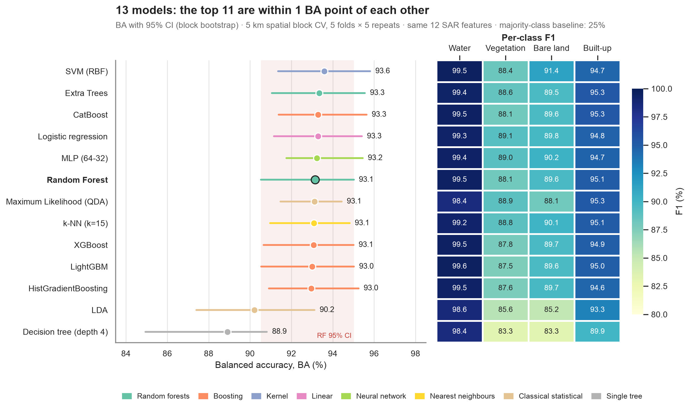

| Model | BA (95% CI) | OA | Macro F1 | kappa | F1 Water | F1 Vegetation | F1 Bare land | F1 Built-up |
|---|---|---|---|---|---|---|---|---|
| SVM (RBF) | **93.6** (91.4–95.8) | 95.6 | 93.5 | 0.933 | 99.5 | 88.4 | 91.4 | 94.7 |
| Extra Trees | 93.3 (91.1–95.6) | 95.3 | 93.2 | 0.929 | 99.4 | 88.6 | 89.5 | 95.3 |
| CatBoost | 93.3 (91.4–95.6) | 95.3 | 93.1 | 0.929 | 99.5 | 88.1 | 89.6 | 95.3 |
| Logistic regression | 93.3 (91.2–95.4) | 95.3 | 93.2 | 0.929 | 99.3 | 89.1 | 89.8 | 94.8 |
| MLP (64-32) | 93.2 (91.8–95.4) | 95.5 | 93.4 | 0.931 | 99.4 | 89.0 | 90.2 | 94.7 |
| Random Forest | 93.1 (90.5–95.0) | 95.3 | 93.1 | 0.929 | 99.5 | 88.1 | 89.6 | 95.1 |
| Maximum Likelihood (QDA) | 93.1 (91.5–94.4) | 94.6 | 92.7 | 0.918 | 98.4 | 88.9 | 88.1 | 95.3 |
| k-NN (k=15) | 93.1 (91.0–94.8) | 95.3 | 93.3 | 0.929 | 99.2 | 88.8 | 90.1 | 95.1 |
| XGBoost | 93.1 (90.7–95.0) | 95.2 | 93.0 | 0.928 | 99.5 | 87.8 | 89.7 | 94.9 |
| LightGBM | 93.0 (90.5–95.0) | 95.2 | 92.9 | 0.927 | 99.6 | 87.5 | 89.6 | 95.0 |
| HistGradientBoosting | 93.0 (90.9–95.2) | 95.1 | 92.8 | 0.926 | 99.5 | 87.6 | 89.7 | 94.6 |
| LDA | 90.2 (87.4–93.1) | 93.5 | 90.7 | 0.900 | 98.6 | 85.6 | 85.2 | 93.3 |
| Decision tree (depth 4) | 88.9 (84.9–90.8) | 92.0 | 88.7 | 0.879 | 98.4 | 83.3 | 83.3 | 89.9 |
| Baseline: majority class | 25.0 | 51.3 | 17.0 | 0.000 | 67.8 | 0 | 0 | 0 |

BA, OA and F1 in %; BA, OA, F1 and kappa are means over 5 repeats; confidence intervals from the block bootstrap on the first repeat.

- **Main finding:** the top 11 models are within 1 BA point of each other. Differences relative to Random Forest range from −0.0 to +0.8 points, and their confidence intervals either include 0 or come close to it.
- **A linear model is good enough:** logistic regression (93.3%) matches complex tree ensembles. With these 12 features the data are almost linearly separable.
- **Clearly weaker models:** only LDA (−2.6 points) and the shallow decision tree (−4.8 points) are meaningfully worse than Random Forest.
- **Training time** per fit (about 3,100 samples): from 0.003 s (LDA) to 6.5 s (HistGradientBoosting); Random Forest 0.4 s.

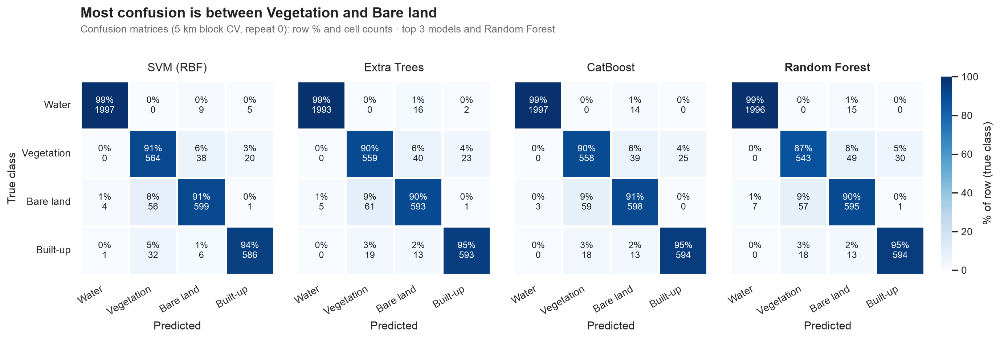

- **The main confusion for every model is Vegetation ↔ Bare land,** about 6–9% in each direction, followed by Built-up predicted as Vegetation (3–5%).
- **Water is almost never confused** (99%).

### 5.2 Contribution of feature groups (E2, Random Forest)

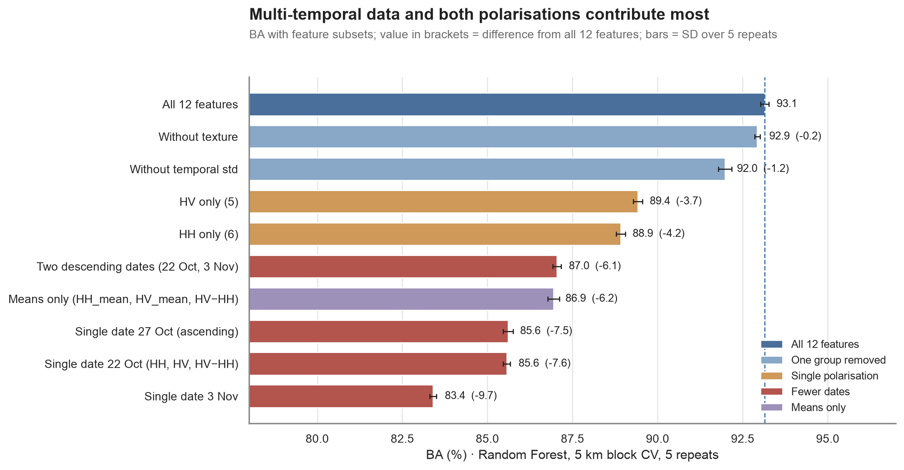

| Feature set | Number of features | BA |
|---|---|---|
| All 12 features | 12 | **93.1** |
| Without texture | 11 | 92.9 |
| Without temporal standard deviation | 10 | 92.0 |
| HV only | 5 | 89.4 |
| HH only | 6 | 88.9 |
| Two descending dates (22 Oct, 3 Nov) | 4 | 87.0 |
| Means only (HH, HV, HV − HH) | 3 | 86.9 |
| Single date 22 Oct | 3 | 85.6 |
| Single date 27 Oct (ascending) | 3 | 85.6 |
| Single date 3 Nov | 3 | 83.4 |

- **Multi-temporal data matter most:** three dates give 7–10 points more BA than one date. The gain comes both from more observations and from two look directions: the two descending dates together reach only 87.0%.
- **Both polarisations are needed:** dropping either HV or HH costs about 4 points.
- **Texture contributes almost nothing** (0.2 points) and could be dropped.

### 5.3 Permutation importance (E3, Random Forest, on test folds)

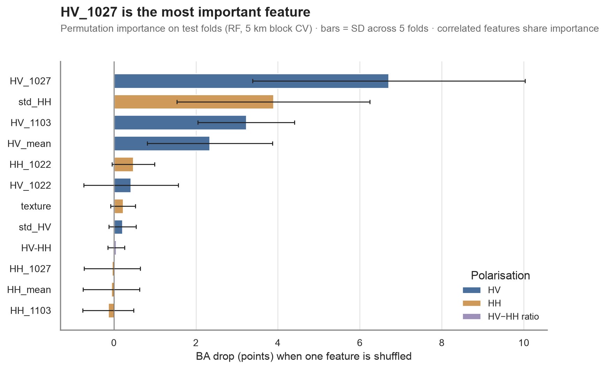

Drop in BA when a single feature is randomly shuffled:

| Feature | BA drop (points) |
|---|---|
| HV on 27 Oct | 6.7 ± 3.3 |
| Standard deviation of HH | 3.9 ± 2.4 |
| HV on 3 Nov | 3.2 ± 1.2 |
| Mean HV | 2.3 ± 1.5 |
| All other features | below 0.5 |

- **HV on 27 Oct is the most important feature,** and it is the only ascending acquisition. The standard deviation of HH ranks second. This feature mixes in look-direction differences, and building backscatter depends on look direction, so it may have a physical meaning. This hypothesis has not been verified.
- **How to read it:** when features are correlated (for example per-date HH and mean HH), their individual importance is split between them. This table should be read together with E2.

### 5.4 Validation design and spatial leakage (E4)

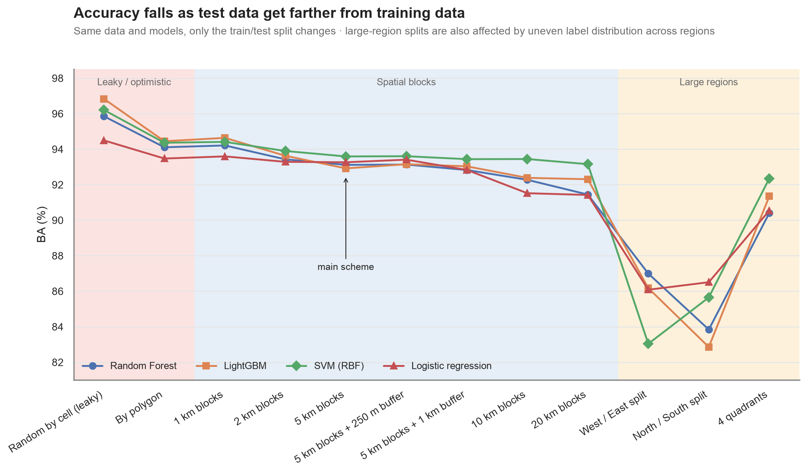

| Train/test split | Test → train distance (median) | RF | LightGBM | SVM | Logistic regression |
|---|---|---|---|---|---|
| Random by cell (leaky) | 20 m | 95.9 | 96.8 | 96.2 | 94.5 |
| By polygon | 300 m | 94.1 | 94.4 | 94.4 | 93.5 |
| 1 km blocks | 501 m | 94.2 | 94.6 | 94.4 | 93.6 |
| 2 km blocks | 800 m | 93.4 | 93.6 | 93.9 | 93.3 |
| **5 km blocks (primary)** | 1,686 m | **93.1** | 92.9 | 93.6 | 93.3 |
| 5 km blocks + 250 m buffer | 1,920 m | 93.1 | 93.2 | 93.6 | 93.4 |
| 5 km blocks + 1 km buffer | 2,500 m | 92.8 | 93.0 | 93.4 | 92.8 |
| 10 km blocks | 2,925 m | 92.3 | 92.4 | 93.4 | 91.5 |
| 20 km blocks | 4,099 m | 91.4 | 92.3 | 93.2 | 91.4 |
| West / East split | 18.7 km | 87.0 | 86.2 | 83.0 | 86.1 |
| North / South split | 17.9 km | 83.8 | 82.9 | 85.7 | 86.5 |
| 4 quadrants | 15.0 km | 90.4 | 91.3 | 92.4 | 90.5 |

A buffer means removing training cells closer than that distance to the nearest test cell.

- **Spatial leakage is real:** a random per-cell split scores about 3 points higher, because test cells are only 20 m from training cells. A per-polygon split is also about 1 point optimistic, because same-class polygons were drawn close together.
- **The smoothed features cause no meaningful leakage across block boundaries:** a 250 m buffer, larger than the 140 m feature window, leaves the result essentially unchanged.
- **Accuracy declines slowly with block size:** from 93.1% (5 km) to 91.4% (20 km) for RF. SVM is the most stable (93.2% with 20 km blocks).
- **Splitting the province in halves causes a large drop** (83–87%), but this is confounded with uneven labels. For example, Built-up has 618 samples in the northern half and only 7 in the southern half, so a model trained on the south barely learns Built-up. Vegetation is also uneven (West 209 / East 413). This drop therefore also measures "a class missing from a region", not purely the ability to transfer between regions.

**BA by distance from test cell to nearest training cell (RF, 5 km blocks):**

| Distance | < 500 m | 500 m – 2 km | 2 – 5 km |
|---|---|---|---|
| BA | 98–100% | 93.7% | 90.7% |

**Distance from every AOI cell to the nearest training sample** (computed separately):

| Distance | < 500 m | 0.5 – 2 km | 2 – 5 km | 5 – 10 km |
|---|---|---|---|---|
| % of AOI cells | 12% | 44% | 32% | 12% |

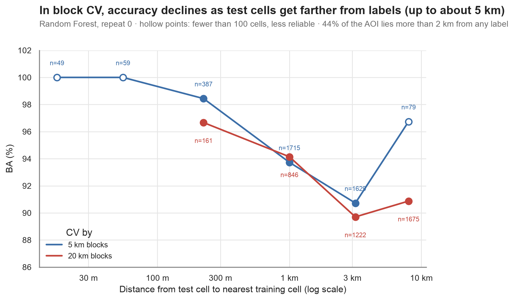

Almost half of the AOI lies more than 2 km from any label. At those distances the measured accuracy on pure cells is about 90% (89.7–90.9%), below the 93% of the full CV. This is another reason not to read 93% as whole-map accuracy.

### 5.5 Learning curve: how many labels are needed? (E5)

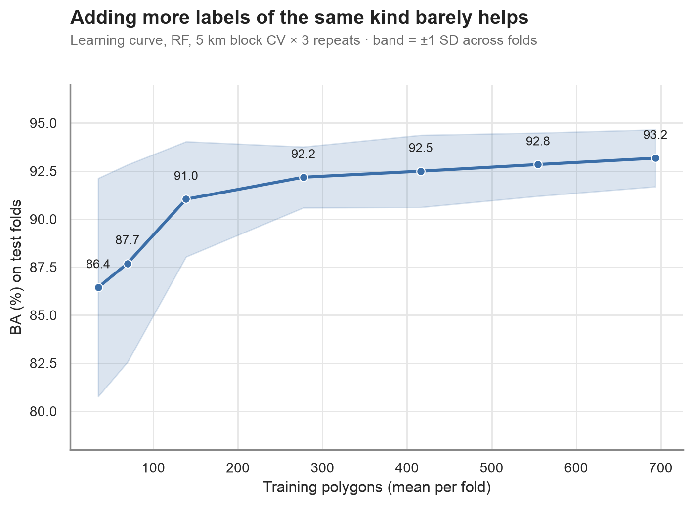

| Share of polygons used for training | 5% | 10% | 20% | 40% | 60% | 80% | 100% |
|---|---|---|---|---|---|---|---|
| Polygons (mean per fold) | 35 | 69 | 139 | 277 | 416 | 555 | 694 |
| BA | 86.4 | 87.7 | 91.0 | 92.2 | 92.5 | 92.8 | 93.2 |

- **The curve nearly saturates after about 300 polygons.** Going from 40% to 100% of the polygons adds only 1 point, so drawing more labels *of the same kind* barely helps.
- **More diverse labels might help:** in under-sampled regions (Built-up in the south) and on hard cells (mixed cells, freshly harvested fields).

### 5.6 Hyperparameter tuning with nested CV (E6)

Outer loop: 5 km block CV; inner loop: 3-fold GroupKFold by block, selecting by BA.

| Model | Default BA | Tuned BA | Grid |
|---|---|---|---|
| Random Forest | 92.9 | 92.8 | `max_features` ∈ {√p, 0.5, 1}, `min_samples_leaf` ∈ {1, 2, 5} |
| SVM (RBF) | 93.6 | 94.1 | C ∈ {1, 10, 100}, γ ∈ {scale, 0.03, 0.3} |
| LightGBM | 92.9 | 93.1 | `num_leaves` ∈ {15, 31, 63}, `learning_rate` ∈ {0.03, 0.1} |

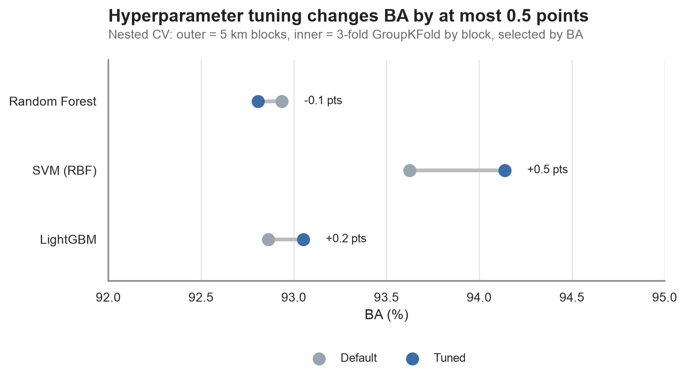

- **Tuning barely helps** (at most 0.5 points).
- **SVM** selects C = 1 in all 5 folds, i.e. a less complex model than the default (C = 10) does slightly better.

### 5.7 Map level: do the models produce the same map? (E7)

10 models were trained on all 3,918 samples and then predicted all 6.43 million AOI cells.

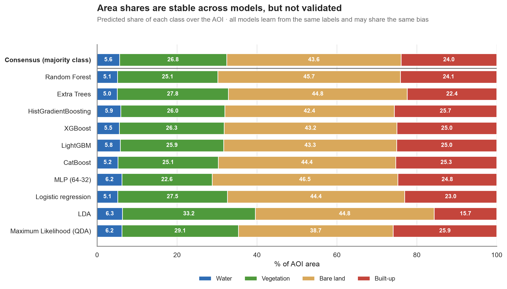

| Model | Water | Vegetation | Bare land | Built-up |
|---|---|---|---|---|
| Random Forest | 5.1 | 25.1 | 45.7 | 24.1 |
| Extra Trees | 5.0 | 27.8 | 44.8 | 22.4 |
| HistGradientBoosting | 5.9 | 26.0 | 42.4 | 25.7 |
| XGBoost | 5.5 | 26.3 | 43.2 | 25.0 |
| LightGBM | 5.8 | 25.9 | 43.3 | 25.0 |
| CatBoost | 5.2 | 25.1 | 44.4 | 25.3 |
| MLP | 6.2 | 22.6 | 46.5 | 24.8 |
| Logistic regression | 5.1 | 27.5 | 44.4 | 23.0 |
| LDA | 6.3 | 33.2 | 44.8 | 15.7 |
| Maximum Likelihood (QDA) | 6.2 | 29.1 | 38.7 | 25.9 |
| **Consensus (majority class)** | **5.6** | **26.8** | **43.6** | **24.0** |

Values are predicted % of AOI area, not bias-corrected.

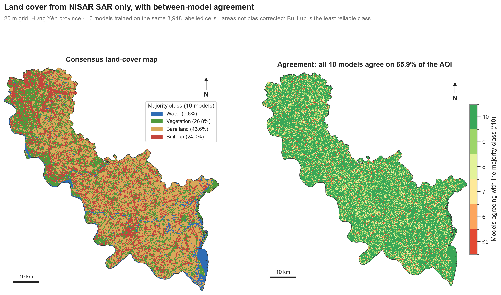

- **Agreement:** all 10 models predict the same class on **65.9%** of the AOI; only 3.0% of cells have 5 or fewer models agreeing with the majority class.
- **Pairwise agreement:** 89–97% among tree-based models; LDA and QDA agree with the others on only 76–86% of cells.

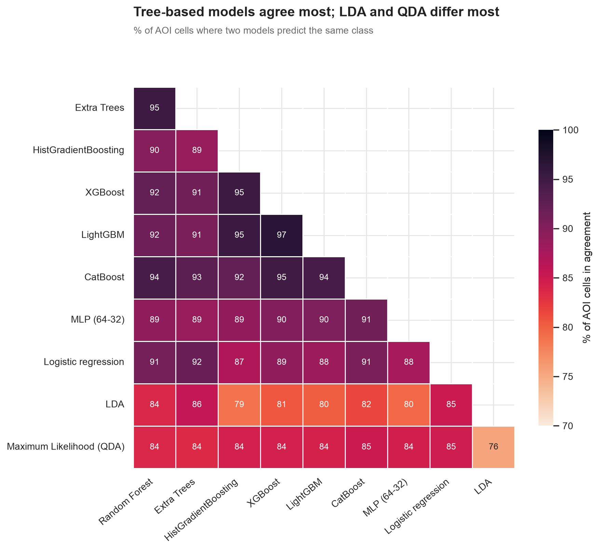

- **Area shares are fairly stable across models** (excluding LDA): Built-up 22–26%, Bare land 39–47%. **But stable does not mean correct:** all models learn from the same labels and carry the same bias. A Built-up share of about 24% looks high for an agricultural delta province, and there is no independent data to check it.
- **The consensus map and the agreement count** are saved as `data/derived/landcover_model_mode.tif` and `landcover_model_agreement.tif`. The agreement count can serve as a "confidence" layer on the web map.

### 5.8 Area of applicability (E8)

Method: *Area of Applicability* (Meyer & Pebesma, 2021):
- For each AOI cell, compute the distance in feature space (standardised and weighted by permutation importance) to the nearest training sample, divided by the mean distance between training samples. This is the dissimilarity index DI.
- The threshold is the upper whisker of the boxplot of DI computed within the 5 km block CV. Cells with DI above the threshold are considered outside the region the model has "seen".

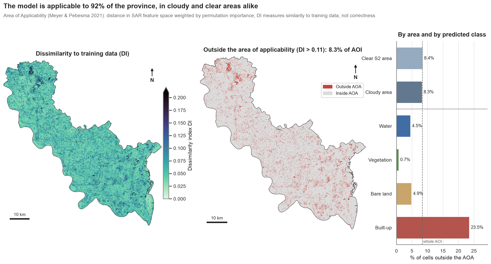

- **8.3% of the AOI is outside the area of applicability.** The share is the same in areas with clear S2 imagery (8.4%) and in cloudy areas (8.3%); the median DI is also equal (0.048). Drawing labels only in cloud-free areas therefore does *not* make the samples less representative in SAR feature space. This is a good result for the goal of using SAR under clouds.
- **Cells outside the AOA by predicted class:** **23.5%** of cells predicted as Built-up, versus 4.5–4.9% for Water and Bare land and 0.7% for Vegetation. Built-up is the least reliable class on the map. These cells concentrate in the north of the province; they have not been checked against a base map to identify the surface type.
- **Limitation of DI:** it measures similarity to the training data, not correctness. In CV, BA does not fall steadily with DI: 86.7%, 94.2%, 91.1%, 83.6% for the four DI quartiles in increasing order. One possible reason is that the lowest-DI quartile falls in the Vegetation/Bare-land overlap zone; this has not been checked.

## 6. Limitations and open issues

1. **No independent test set.** All metrics are cross-validation on the same label set drawn by one team. A blind test set of 250 random cells was created (`labeling/blind_test_cells.gpkg`) but has not been labelled.
2. **Pure cells only.** Samples are cells lying entirely within a single-class rectangle. The map also covers mixed cells (villages with trees, small ponds, fields interspersed with houses), where accuracy is certainly lower but has not been measured.
3. **Clustered and uneven labels:** classes were drawn in clusters, one half of the province has more samples than the other, and Built-up is almost exclusively in the north. This limits diversity and worsens region-split results.
4. **Class definitions:** the "Buildings" labels are dense building blocks, whereas the map's "Built-up" class may also capture villages with trees. This is one possible explanation for the ~24% Built-up share; not verified.
5. **Imperfect temporal match:** labels were drawn on a 12-day S2 median composite. The ground may have changed within that window (rice harvest, field flooding), so some labels may not match the SAR acquisition dates.
6. **Variability features mix look directions:** 27 Oct is ascending, the other dates descending, so the "standard deviation across 3 dates" features are not purely temporal change.
7. **Small polygons discarded:** 36% of the polygons cannot be used on the 20 m grid, mostly vegetation.
8. **No post-processing:** the map still has salt-and-pepper noise and has not been smoothed.
9. **Area shares not bias-corrected:** there is no design-based area estimate (Olofsson et al., 2014), which would require a probability-sampled test set (the blind set in item 1).

## 7. Conclusions

- **Four-class mapping from multi-temporal NISAR L-band SAR alone is feasible:** BA about 93% on pure cells under spatial-block validation. The result is robust to the choice of model, tuning and buffering, and declines only gradually as test areas get farther from labelled areas.
- **Multi-temporal data and both polarisations are what matter,** not model complexity. This supports exploiting NISAR's repeat acquisitions.
- **Model recommendation:** Random Forest (current) or SVM are both suitable; switching models brings no meaningful benefit.
- **When presenting the map,** include a confidence layer (E7 agreement, E8 area of applicability). The Built-up class and all area figures must be clearly flagged as unvalidated.

## 8. Reproducibility

```bash
# 1. Merge the ArcGIS Pro label shapefiles into a GeoPackage
/Users/ninhhaidang/miniconda3/envs/dwts/bin/python -I scripts/merge_label_polygons.py "<shapefile folder>"
# 2. Train the main model and write the map data/derived/landcover_sar_20m.tif
/Users/ninhhaidang/miniconda3/envs/dwts/bin/python -I scripts/train_classifier.py
# 3. All experiments E0–E8 (about 35 minutes on an 8-core machine); run a subset with --only E1,E4
/Users/ninhhaidang/miniconda3/envs/dwts/bin/python -I scripts/experiments.py
# 4. Draw all figures in both languages (vi/, en/) and export English tables (en/tables/); about 1 minute
/Users/ninhhaidang/miniconda3/envs/dwts/bin/python -I scripts/plot_experiments.py
```

- **Environment:** conda env `dwts`. Main versions: scikit-learn 1.9.1, numpy 2.5.4, XGBoost 3.4.2, LightGBM 4.7.0, CatBoost 1.2.10 (conda-forge).
- **Random seeds** are fixed (0). Re-running may differ very slightly because Random Forest runs in parallel; for example the main map differed by 1 cell out of 6.4 million between two runs.
- **Data** in `data/` are not committed to git. NISAR data can be re-downloaded from ASF and clipped with `scripts/crop_gcov.py`.

**References**
- Meyer, H. & Pebesma, E. (2021). Predicting into unknown space? Estimating the area of applicability of spatial prediction models. *Methods in Ecology and Evolution*, 12, 1620–1633.
- Olofsson, P. et al. (2014). Good practices for estimating area and assessing accuracy of land change. *Remote Sensing of Environment*, 148, 42–57.
